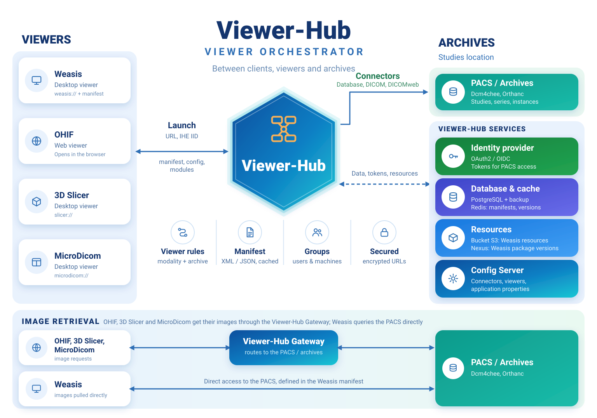


# ViewerHub
ViewerHub allows to manage various viewers on a IT Infrastructure. 

## Architecture






Note: Currently in our example Weasis is still using the authentication filled in the manifest to retrieve data from the pacs.

## Documentation
https://weasis.org/en/viewer-hub/index.html

## Main functionalities
- Launch of multiple viewers (Weasis, OHIF, 3D Slicer, MicroDicom) with several launch endpoints, including IHE IID Profile-compatible launch
- Viewer selection rules based on a combination of list of modalities and archive
- Creation and association of user or machine groups
- Creation of an xml file (manifest) containing the studies, series and instances to be downloaded. This file will then be transmitted to Weasis to load the images into the viewer.
- Manifest storage in a redis cache
- Storage of resources required by the different versions of Weasis on Minio/S3
- Creation of versions of Weasis launched only for certain groups
- Live changes of Weasis properties 
- Versions management of i18n translations used by Weasis
- Compatibility management between versions of Weasis installed on clients and versions of resources uploaded in Viewer-Hub (storage on Minio S3 + cache)
- Pacs connectors management
- Retrieve OAuth2 tokens on IDP to enable Weasis to authenticate on dcm4chee pacs
- Cryptography of launch urls
- Retrieve in Nexus the stored package versions of Weasis

## Launch the different containers in local

If you want to launch all the containers:
- Via the terminal, go to the folder "docker": cd docker

- Launch via the following docker command:
```
docker compose -p imaging_hub -f docker-compose.yml -f docker-compose.local.yml up -d
```

- Or launch via this command script:

```bash
  cd docker && ./scripts/start.sh local
```

## Minio

The service "create-bucket" in docker-compose.local.yml will launch the creation of a bucket and an access key for ViewerHub.

It is also possible to create the bucket/access key manually:

- Access to the Minio console:
```  
http://localhost:9090
```
with

```
User: viewer-hub
Password: viewer-hub
```

- Once logged, go to Administrator -> Buckets and fill the bucket name with "viewer-hub-bucket", then create the bucket.
- Then go to User -> Access Keys and create the access key "access-key" with the secret key "secret-key"

## Keycloak

In order to access to the keycloak console: 
```
http://localhost:8085
```
with
```
User: admin
Password: admin
```

When launching Keycloak with the docker-compose file keycloak.yml in the docker folder, a configuration 
is directly imported in the keycloak container. This configuration will create: 
- a realm "viewer-hub"
- a client "viewer-hub" in order for the manager to connect with the authorization grant type "authorization_code"
- a user "viewer-hub-user" which will have a role "admin" associated in order to access to the different "secured" views of the application


## Dcm4chee 

In order to access to the pacs dcm4chee:
```
http://localhost:8080/dcm4chee-arc/ui2/en/study/study
```

As an example, you can import the file "dicom-example" located in the folders "docker" -> "dicom-examples" by using the dcm4chee interface.
("More functions" -> "Upload DICOM Object" -> "Select the STOW-RS server": "DCM4CHEE")

## Nexus

- Nexus console accessible at this address: http://localhost:8086/

## Orthanc

In order to access to the pacs orthanc:
```
http://localhost:8042
```

Use the following credentials:
- User: `orthanc-user`
- Password: `password`

As an example, you can import the file "dicom-example" located in the folders "docker -> dicom-examples" by using the orthanc interface.
("Upload" -> "Select files to upload" and then "Start the upload")

## Run configuration

- Configure the run configuration and add in VM options the following properties:
```
  -Duser.timezone=UTC
  -DENVIRONMENT=local
  -DEUREKA_CLIENT_SERVICE_URL_DEFAULT_ZONE=http://localhost:8761/eureka
  -DREGION=local
  -DDATACENTER=local
  -Dserver.port=8081
  -Dmanagement.server.port=19001
  -DBACKEND_URI=http://localhost:8081
  -DDB_HOST=localhost
  -DDB_PORT=45101
  -DDB_NAME=viewer-hub
  -DDB_USER=viewer-hub
  -DDB_PASSWORD=viewer-hub
  -DCONFIGSERVER_URI=http://localhost:8888
  -DS3_ACCESS_KEY=access-key
  -DS3_SECRET_KEY=secret-key
  -DS3_ENDPOINT=http://localhost:9080
  -DS3_BUCKET_NAME=viewer-hub-bucket
  -DBACKEND_URI=http://localhost:8081
```
- Then clean/install + run...

## Viewer Hub

In order to access to viewer-hub: 
```
http://localhost:8081
```
with

```
User: viewer-hub-user
Password: password
```

## Eureka

Once ViewerHub launched, it is possible to see the registration of the service at this address:
```
http://localhost:8761
```

## Viewer-Hub Gateway

ViewerHub gateway is used to handle different type of authentication in order for viewers to get authentified when requesting data from the pacs.

ViewerHub Gateway handles basic authentication and oAuth2 (client credential and authorization code flow).

In order to run Viewer-hub gateway for the viewers Ohif, 3D Slicer, Microdicom: https://github.com/nroduit/viewer-hub-gateway

## Local Testing

If there is an issue with the cors when testing and launching below urls in local, open Chrome without cors: in cmd => "C:\Program Files\Google\Chrome\Application\chrome.exe" --user-data-dir="C:\chrome-dev-data" --disable-web-security

## Launch Weasis

Spring profile "connectors-dicom-no-gtw":

Dcm4chee:
```
http://localhost:8081/display?viewer=WEASIS&studyUID=1.3.12.2.1107.5.1.4.54023.30000004093013443132800000021&archive=dcm4chee-local
```

Orthanc:
```
http://localhost:8081/display?viewer=WEASIS&studyUID=1.3.12.2.1107.5.1.4.54023.30000004093013443132800000021&archive=orthanc-local
```

Spring profile "connectors-dicom-gtw":

Dcm4chee:
```
http://localhost:8081/display/auth?viewer=WEASIS&studyUID=1.3.12.2.1107.5.1.4.54023.30000004093013443132800000021&archive=dcm4chee-local
```

Orthanc:
```
http://localhost:8081/display/auth?viewer=WEASIS&studyUID=1.3.12.2.1107.5.1.4.54023.30000004093013443132800000021&archive=orthanc-local
```

## Launch Ohif

Spring profile "connectors-dicom-no-gtw":

Dcm4chee 
```
http://localhost:8081/display?viewer=OHIF&studyUID=1.3.12.2.1107.5.1.4.54023.30000004093013443132800000021&archive=dcm4chee-local
```

Orthanc 
```
http://localhost:8081/display?viewer=OHIF&studyUID=1.3.12.2.1107.5.1.4.54023.30000004093013443132800000021&archive=orthanc-local
```

Spring profile "connectors-dicom-gtw" or "connectors-dicomweb-gtw":

Dcm4chee
```
http://localhost:8081/display/auth?viewer=OHIF&studyUID=1.3.12.2.1107.5.1.4.54023.30000004093013443132800000021&archive=dcm4chee-local
```

Orthanc
```
http://localhost:8081/display/auth?viewer=OHIF&studyUID=1.3.12.2.1107.5.1.4.54023.30000004093013443132800000021&archive=orthanc-local
```

## Launch 3D Slicer

You need to install 3D Slicer in your machine to use it.

Spring profile "connectors-dicom-gtw" or "connectors-dicomweb-gtw":

Dcm4chee
```
http://localhost:8081/display/auth?viewer=SLICER&studyUID=1.3.12.2.1107.5.1.4.54023.30000004093013443132800000021&archive=dcm4chee-local
```

Orthanc
```
http://localhost:8081/display/auth?viewer=SLICER&studyUID=1.3.12.2.1107.5.1.4.54023.30000004093013443132800000021&archive=orthanc-local
```

## Launch Micro Dicom

You need to install Micro Dicom in your machine to use it.
You also need to add the MICRODICOM AET to the Dcm4chee pacs and to configure the Dicom server corresponding to the Dcm4chee pacs in MicroDicom (localhost:11112, aet DCM4CHEE)

Spring profile "connectors-dicom-no-gtw":

Dcm4chee
```
http://localhost:8081/display?viewer=MICRODICOM&studyUID=1.3.12.2.1107.5.1.4.54023.30000004093013443132800000021&archive=dcm4chee-local
```

Orthanc
```
http://localhost:8081/display?viewer=MICRODICOM&studyUID=1.3.12.2.1107.5.1.4.54023.30000004093013443132800000021&archive=orthanc-local
```

## Package versions refresh and circuit breaker

The available Weasis package versions (S3 + DB) are computed into the cache by `PackageServiceImpl.refreshAvailablePackageVersion()`, executed through `PackageVersionRefresher`.
If this computation fails (S3, DB, network...), it is automatically retried until it succeeds, protected by
the Resilience4j `@CircuitBreaker` annotation (circuit breaker `packageVersionRefresh`, with a fallback method).

Triggers of the refresh:
- Every 8h (and at startup)
- Retry job (`PackageVersionRefreshRetryJob`) every minute, only when the last refresh failed and the circuit is not open
- Upload / deletion of a package version

```
 Refresh triggers (8h, retry job, upload/delete)
                     |
                     v
       refreshAvailablePackageVersion()
                     |
                     v
          +----------------------+
          |   Circuit breaker    |
          +----------------------+
           |CLOSED     |OPEN          |HALF-OPEN
           |           |(5 min)       |(1 trial call)
           v           v              v
       run refresh   call rejected   run refresh
                     -> fallback
           |
     +-----+------+
  success       failure (S3/DB/network)
     |              |
     |              v
     |        fallback: log warn, pending = true
     v              (cache untouched until the computation completes)
  pending = false
```

Example of an outage and its recovery:

```
t=0      Refresh                  -> failure 1/3  circuit CLOSED      pending=true
t=1min   Retry job                -> failure 2/3  circuit CLOSED      pending=true
t=2min   Retry job                -> failure 3/3  circuit OPEN        pending=true
t=3..6min Retry job               no retry while the circuit is OPEN
t=7min   5 min elapsed            circuit HALF-OPEN (automatic)
t<=8min  Retry job (trial call)   -> failure      circuit OPEN (5 min)
...      one trial every ~6 min while the outage lasts
t=N      Outage solved
t<=N+6min Retry job (trial call)  -> success      circuit CLOSED      pending=false
```

Notes:
- The retry job runs every minute: it retries when the circuit is closed or half-open (1 min), and does nothing while it is open (5 min).
  The open state also protects against the other callers (upload, deletion).
- There is no timeout on the refresh: a call blocked forever is neither a success nor a failure (rely on the S3/DB client timeouts).
- If a failure happens after the cache has been cleared, the cache may stay partial until the next retry.
- The annotation only applies to calls going through the Spring proxy: `PackageServiceImpl` therefore delegates the refresh (as a `Runnable`) to the `PackageVersionRefresher` bean, which holds the `@CircuitBreaker` and the pending state.

Circuit breaker properties (`application.yml`, `resilience4j.circuitbreaker.instances.packageVersionRefresh`):

| Property | Default | Description |
|----------|---------|-------------|
| `sliding-window-size` / `minimum-number-of-calls` | `3` | Calls evaluated before opening the circuit |
| `failure-rate-threshold` | `100` | Percentage of failures opening the circuit |
| `wait-duration-in-open-state` | `5m` | Time in open state before the trial call |
| `permitted-number-of-calls-in-half-open-state` | `1` | Trial calls in half-open state |

Retry job: `viewer-hub.package-version-refresh.retry-delay-ms` (default `60000`), delay between two executions (retry when the circuit is closed or half-open).

